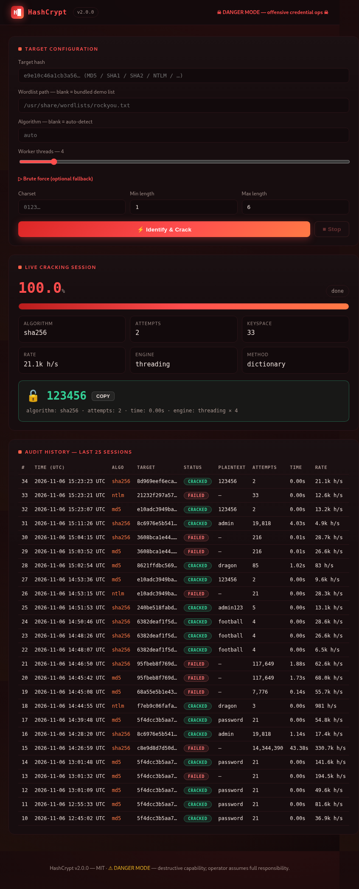

# HashCrypt

**Hash identification and password-auditing toolkit** built with Python. HashCrypt analyzes hash strings, runs dictionary and brute-force candidate searches, provides a command-line interface and an optional Flask dashboard, and stores local audit records in SQLite.

> **Authorized-use notice:** HashCrypt is intended for coursework, controlled labs, and security assessments that you own or are explicitly authorized to perform. Do not use it to access accounts, systems, or data without permission. You are responsible for complying with applicable laws and rules.

<p align="center">
  
</p>

## Table of Contents

- [Overview](#overview)
- [Features](#features)
- [Supported Algorithms and Formats](#supported-algorithms-and-formats)
- [Requirements](#requirements)
- [Installation](#installation)
- [Quick Start](#quick-start)
- [CLI Reference](#cli-reference)
- [Web Dashboard](#web-dashboard)
- [Audit Database](#audit-database)
- [Project Structure](#project-structure)
- [Tests and Continuous Integration](#tests-and-continuous-integration)
- [Current Limitations](#current-limitations)
- [Security and Privacy](#security-and-privacy)
- [License](#license)

## Overview

HashCrypt is an educational credential-auditing utility organized into four main phases:

1. **Hash identification:** inspects the input length, character set, and recognizable format markers, then returns ranked algorithm candidates.
2. **Candidate search:** compares a target hash against words from a wordlist or candidates generated from a character set.
3. **User interfaces:** exposes the functionality through a terminal CLI and an optional local web dashboard.
4. **Audit logging:** records completed sessions and summary statistics in a local SQLite database.

HashCrypt does not decrypt hashes. It hashes candidate values and compares the resulting digest with the supplied target.

## Features

- Hash analysis using digest length, character composition, and format markers.
- Dictionary search using a supplied wordlist.
- Brute-force search over a user-defined character set and length range.
- Thread-based brute-force execution and optional process-based execution.
- Optional multiprocessing for dictionary searches with the `-p` flag.
- Basic salt handling by prepending or appending a supplied salt to each candidate.
- Live CLI progress, attempt counts, speed, and estimated time remaining.
- Cooperative cancellation using `Ctrl+C` in the CLI or the Stop control in the dashboard.
- Optional Flask dashboard for submitting jobs and viewing their status.
- SQLite audit history for completed attempts, including successful and unsuccessful results.
- CLI utility for generating reference hashes during testing.

## Supported Algorithms and Formats

### Built-in candidate-search engine

The built-in engine supports the following digest algorithms:

| Family | Supported algorithms |
|---|---|
| MD5 | MD5 |
| Windows credentials | NTLM |
| SHA-1 | SHA-1 |
| SHA-2 | SHA-224, SHA-256, SHA-384, SHA-512 |
| SHA-3 | SHA3-224, SHA3-256, SHA3-384, SHA3-512 |
| BLAKE2 | BLAKE2b, BLAKE2s |

NTLM calculation uses MD4 over the password encoded as UTF-16LE. HashCrypt includes a pure-Python MD4 fallback because some OpenSSL builds do not expose MD4 through Python's `hashlib`.

### Identification only

The identifier recognizes additional formats and markers, including bcrypt, Unix `md5crypt` / `sha256crypt` / `sha512crypt`, Apache APR1, Argon2, PBKDF2, SCRAM, LM, and selected MySQL formats. **Recognition does not mean the built-in engine can crack that format.** Formats that require a dedicated password-hashing/KDF implementation are reported as identification-only.

> Hash identification is heuristic. Different algorithms can produce strings with the same length and character set (for example, MD5 and NTLM are both commonly represented by 32 hexadecimal characters). Use `--algo` to select the algorithm when it is known.

## Requirements

- Python 3.9 or newer.
- Git (to clone the repository).
- Flask 2.3 or newer only if you want to use the web dashboard.
- No third-party dependencies are required for the core CLI and candidate-search engine; they use the Python standard library.

## Installation

### Windows (PowerShell)

```powershell
git clone https://github.com/MuadhElsayed/Hash-Cracker.git
cd Hash-Cracker

py -m venv .venv
.\.venv\Scripts\Activate.ps1
python -m pip install --upgrade pip

# Core CLI
python -m pip install -e .

# Optional: install Flask for the web dashboard
python -m pip install -e ".[web]"
```

### Linux / Kali Linux

```bash
git clone https://github.com/MuadhElsayed/Hash-Cracker.git
cd Hash-Cracker

python3 -m venv .venv
source .venv/bin/activate
python -m pip install --upgrade pip

# Core CLI
python -m pip install -e .

# Optional: install Flask for the web dashboard
python -m pip install -e ".[web]"
```

After installation, the `hashcrypt` command is available in the active environment. You can also run it from the repository root without installing the console command:

```bash
python -m hashcrypt --help
```

## Quick Start

### 1. Generate reference hashes

Use this command to generate hashes for controlled tests:

```bash
hashcrypt gen dragon --algorithms md5 ntlm sha256
```

### 2. Identify a hash

```bash
hashcrypt identify 8621ffdbc5698829397d97767ac13db3
```

The identifier reports the input length, character set, ranked candidates, and whether a candidate can be handled by the built-in engine.

### 3. Run a dictionary search

Use the small wordlist included with the repository for a quick demonstration:

```bash
hashcrypt crack 8621ffdbc5698829397d97767ac13db3 \
  --wordlist wordlists/common_passwords.txt \
  --algo md5 \
  --threads 4
```

You can provide another wordlist with `-w` / `--wordlist`. Large wordlists are not included in this repository; for example, a locally installed Kali wordlist can be supplied by its local path.

### 4. Run a brute-force search

The following example searches strings of length 1 to 3 formed from the characters `a`, `b`, `c`, `x`, `y`, and `z`:

```bash
hashcrypt crack <TARGET_SHA256> \
  --algo sha256 \
  --brute abcxyz \
  --lengths 1 3 \
  --threads 4
```

Replace `<TARGET_SHA256>` with a SHA-256 hash generated for a test value in the allowed candidate space. The total keyspace is:

\[
N = \sum_{k=m}^{n} |C|^k
\]

where `C` is the character set and `m` / `n` are the minimum and maximum candidate lengths.

### 5. Use multiprocessing

Add `-p` / `--processes` to use worker processes instead of the default execution mode:

```bash
hashcrypt crack <TARGET_HASH> \
  --wordlist wordlists/common_passwords.txt \
  --algo md5 \
  --threads 4 \
  --processes
```

### 6. Apply a simple prefix or suffix salt

HashCrypt can prepend or append a supplied salt to each candidate:

```bash
hashcrypt crack <TARGET_HASH> \
  --wordlist wordlists/common_passwords.txt \
  --algo sha256 \
  --salt 2024 \
  --salt-pos prepend
```

This option models simple candidate concatenation. It is not a general implementation of salted password formats such as bcrypt, Argon2, or PBKDF2.

### 7. Review audit history and statistics

```bash
hashcrypt history
hashcrypt history --found-only --limit 10
hashcrypt stats
```

### 8. Launch the web dashboard

Install the optional web dependency first, then run:

```bash
hashcrypt web --host 127.0.0.1 --port 5000
```

Open [http://127.0.0.1:5000](http://127.0.0.1:5000) in your browser.

## CLI Reference

| Command | Description |
|---|---|
| `hashcrypt --help` | Show general help. |
| `hashcrypt --version` | Print the installed version. |
| `hashcrypt identify <HASH>` | Analyze a hash string. |
| `hashcrypt gen <WORD>` | Generate reference hashes for a word. |
| `hashcrypt crack <HASH>` | Run a dictionary search, brute-force search, or both. |
| `hashcrypt history` | Display recent audit records. |
| `hashcrypt stats` | Display aggregate audit statistics. |
| `hashcrypt web` | Start the optional Flask dashboard. |

### Common `crack` options

| Option | Description |
|---|---|
| `-w`, `--wordlist PATH` | Path to a dictionary file. |
| `-a`, `--algo NAME` | Force a specific supported algorithm. |
| `-b`, `--brute CHARSET` | Enable brute-force search with the supplied characters. |
| `-l`, `--lengths MIN MAX` | Minimum and maximum candidate lengths (default: `1 6`). |
| `-t`, `--threads N` | Number of worker threads or processes (default: `4`). |
| `-p`, `--processes` | Use multiprocessing. |
| `--salt VALUE` | Prepend or append a salt to each candidate. |
| `--salt-pos append\|prepend` | Choose where the salt is added (default: `append`). |
| `--db PATH` | Select the SQLite audit database path. |
| `--no-log` | Do not write the session to the audit database. |
| `--note TEXT` | Attach a note to the audit record. |

For complete options, run:

```bash
hashcrypt crack --help
hashcrypt history --help
hashcrypt web --help
```

## Web Dashboard

The optional Flask dashboard provides:

- Hash identification preview.
- Dictionary and brute-force configuration.
- Worker-count configuration.
- Live status, progress, and attempt-rate display.
- A Stop control for a running job.
- Recovered-result display and local audit-history view.

The dashboard currently handles one cracking job at a time and does not provide user authentication. Keep it bound to `127.0.0.1`; do not expose it to a public or untrusted network.

## Audit Database

By default, HashCrypt creates the SQLite database at:

```text
data/audit_log.db
```

The audit data includes fields such as:

- Timestamp, algorithm, target hash, and search method.
- Whether a match was found and the recovered plaintext, if any.
- Attempts, candidate count, elapsed time, and hash rate.
- Worker count, execution engine, and wordlist path.
- Optional salt and user note.

The database is created automatically when a session is logged. It is intentionally excluded from version control because it can contain recovered plaintext credentials and other sensitive audit data.

## Project Structure

```text
Hash-Cracker/
├── .github/
│   └── workflows/
│       └── ci.yml              # GitHub Actions test workflow
├── data/
│   └── .gitkeep                # Keeps the runtime data directory in Git
├── docs/
│   └── dashboard.png           # Web dashboard screenshot
├── hashcrypt/
│   ├── __init__.py             # Package metadata and version
│   ├── __main__.py             # Enables: python -m hashcrypt
│   ├── cli.py                  # Command-line interface
│   ├── identifier.py           # Hash structure and format identification
│   ├── cracker.py              # Dictionary and brute-force engines
│   ├── storage.py              # SQLite audit logging and statistics
│   ├── webapp.py               # Optional Flask application
│   └── templates/
│       └── index.html          # Dashboard frontend
├── tests/
│   └── run_tests.py            # Self-test suite
├── wordlists/
│   └── common_passwords.txt   # Small demonstration wordlist
├── .gitignore
├── LICENSE
├── README.md
├── pyproject.toml              # Packaging and console entry point
└── requirements.txt            # Optional web dependency reference
```

## Tests and Continuous Integration

Run the self-test suite from the repository root:

```bash
python tests/run_tests.py
```

The tests cover hash identification, supported dictionary and brute-force paths, multiprocessing, salt handling, NTLM/MD4 fallback reference vectors, and SQLite audit storage.

The GitHub Actions workflow is configured to test the supported Python matrix (3.9 through 3.13). A green workflow indicates that the automated checks completed successfully for the configured environments.

## Current Limitations

- Hash identification produces ranked candidates; length and character format alone cannot prove which algorithm generated a hash.
- bcrypt, Argon2, PBKDF2, Unix crypt, and other identification-only formats cannot be searched by the built-in engine.
- Dictionary files are loaded into memory and de-duplicated before searching. Very large wordlists may require substantial RAM.
- In the current implementation, dictionary mode uses multiprocessing when `-p` is supplied; without `-p`, it processes its chunks sequentially. Brute-force mode uses threads by default and can use processes with `-p`.
- The tool is implemented in Python for educational use. Its throughput depends on the algorithm, machine, and execution mode; no fixed performance figure is guaranteed.
- GPU acceleration is not implemented.

## Security and Privacy

- Only test hashes you own or are authorized to assess.
- Keep wordlists and audit databases out of public repositories unless you have verified that they contain no sensitive or restricted data.
- The audit database can store recovered plaintext values. Protect it with appropriate filesystem permissions and delete it securely when it is no longer required.
- The web dashboard has no authentication or authorization layer. Use it locally only.
- Do not use HashCrypt as a password-storage system. For application password storage, use a dedicated password-hashing scheme such as Argon2id, scrypt, or bcrypt with appropriate parameters.

## License

This project is distributed under the MIT License. See [LICENSE](LICENSE) for the full text.
